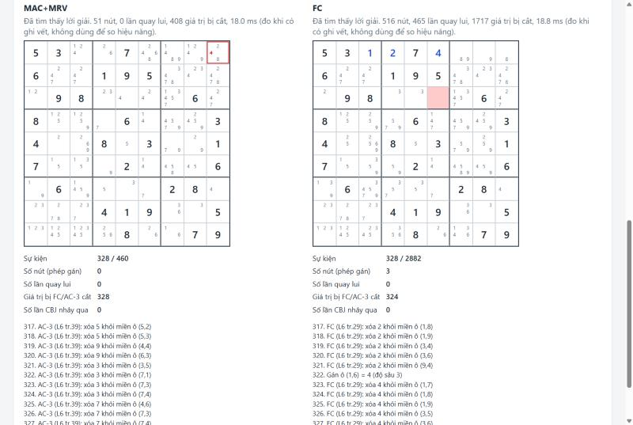

# Sudoku CSP: giải, sinh đề và minh họa thuật toán thỏa mãn ràng buộc

Bài tập lớn môn Nhập môn Trí tuệ nhân tạo (IT3160), nhóm 8.
Giảng viên: Đỗ Tiến Dũng.

Đề tài: mô hình hóa Sudoku 9x9 thành bài toán thỏa mãn ràng buộc (CSP), cài đặt các kỹ thuật tìm kiếm
(quay lui, MRV/Degree, LCV, Forward Checking, AC-3/MAC, Conflict-Directed Backjumping, tìm kiếm cục bộ
Min-Conflicts, Simulated Annealing), sinh đề có nghiệm duy nhất, minh họa từng bước trên giao diện web
và đo đạc, so sánh các kỹ thuật trên bộ đề có kiểm soát.



## Thành viên

| Họ tên | MSSV |
|---|---|
| Nguyễn Thái An | 202416110 |
| Trần Bình Minh | 202416294 |
| Nguyễn Thanh Hải | 202416192 |
| Bùi Hoàng Tú | 202416378 |

## Có gì trong repo

- **Thư viện `sudoku_csp/`** (chỉ dùng thư viện chuẩn Python): một khung quay lui duy nhất với các điểm
  cắm chọn biến (thứ tự cố định, MRV + Degree), chọn giá trị (tăng dần, LCV, ngẫu nhiên), suy diễn
  (không có, Forward Checking, MAC) và kiểu quay lui (thường, CBJ), tức 24 cấu hình; Min-Conflicts với
  hai cách biểu diễn trạng thái; Simulated Annealing; đếm lời giải và sinh đề có nghiệm duy nhất.
- **Giao diện web `app/`**: nhập hoặc sinh đề, kiểm tra số lời giải, chạy một thuật toán rồi phát lại
  từng bước (gán, cắt miền, miền rỗng, quay lui, nhảy CBJ, đổi chỗ, nâng nhiệt) với miền giá trị của
  từng ô, bảng chỉ số, nhật ký giải thích từng bước và biểu đồ chi phí. Có chế độ so sánh song song hai cấu hình.
- **Thí nghiệm `experiments/`**: sinh bộ đề, chạy benchmark (tắt ghi vết), vẽ hình và bảng vào
  `results/`, nhúng hình vào báo cáo.

## Cài đặt

Cần Python 3.11 trở lên. Cách khuyến nghị dùng [uv](https://docs.astral.sh/uv/):

```bash
uv sync --all-extras
```

Nếu chưa có uv, dùng pip trong một môi trường ảo:

```bash
python -m venv .venv
.venv\Scripts\activate
pip install -e ".[analysis,dev]"
```

Các lệnh bên dưới đều gọi qua `python -m` vì trên Windows bật Smart App Control, các file `pytest.exe`,
`uvicorn.exe` trong `.venv` có thể bị chặn chạy trực tiếp. Nếu dùng pip thì bỏ tiền tố `uv run`.

## Chạy giao diện minh họa

```bash
uv run python -m uvicorn app.main:app --reload
```

Mở http://127.0.0.1:8000. Một lượt dùng thử:

1. Chọn một đề trong "Đề mẫu" (ví dụ đề Wikipedia) hoặc bấm "Sinh đề" với số ô cho sẵn mong muốn,
   rồi "Kiểm tra đề" để xem đề có 0, 1 hay nhiều lời giải.
2. Chọn thuật toán và tùy chọn ở mục 2, bấm "Chạy".
3. Ở mục 3, dùng "Phát", "Tiến 1", "Lùi 1" và thanh tua để xem từng sự kiện. Lưới nhỏ 3x3 trong mỗi
   ô là các giá trị còn lại trong miền.
4. Bật "So sánh song song hai cấu hình trên cùng một đề" để chạy cấu hình A và B rồi tua cùng lúc.

Server giới hạn mỗi lượt ở 200 000 nút (hoặc bước), 10 giây và 60 000 sự kiện. Thời gian hiện trên
giao diện được đo khi đang ghi vết nên không dùng để so hiệu năng; số liệu so sánh lấy từ benchmark.

## Tái lập thí nghiệm

Một lệnh tái lập toàn bộ số liệu, bảng và hình trong `results/` (khoảng 21 phút trên máy của nhóm):

```bash
uv run python -m experiments.run_benchmark
```

Lệnh này chạy 24 cấu hình quay lui trên 305 đề và ba phương pháp tìm kiếm cục bộ với ghi vết tắt, ghi
CSV kèm tham số và thông tin máy (`results/env.json`), rồi gọi `plot_results` để ghi
`results/tables.md`, các bảng tổng hợp và bốn hình trong `results/figures/`. Thêm `--quick` để chạy bản
thu nhỏ trong khoảng 10 giây. Số nút và số bước là tất định nên chạy lại cho đúng các con số đó; thời
gian thì phụ thuộc máy.

Các lệnh phụ:

- `uv run python -m experiments.plot_results`: chỉ vẽ lại hình và bảng từ CSV có sẵn.
- `uv run python -m experiments.notebook_attach_figures`: nhúng hình vào báo cáo để notebook hiển thị
  đủ hình trên GitHub và Colab.
- `uv run python -m experiments.make_dataset`: sinh lại `data/puzzles_generated.csv` (7 mức số ô cho
  sẵn x 30 đề, seed cố định) và kiểm tra mọi đề trong `data/top95.txt` có đúng một lời giải. Bộ đề đã
  được commit nên không bắt buộc chạy lại.

## Kiểm thử

```bash
uv run python -m pytest -q
node --test "tests/js/*.test.mjs"
uv run python -m ruff check .
uv run python -m pyright
```

Test JavaScript cần Node 22 trở lên. Giá trị mong đợi trong test được lấy từ lý thuyết hoặc tính tay
(lời giải công bố, đề vô nghiệm dựng tay, bất đẳng thức số nút giữa các kỹ thuật), không lấy từ output
của code. CI trên GitHub Actions chạy toàn bộ các lệnh trên với Python 3.11 và 3.14.

## Thuật toán

| Kỹ thuật | Hàm |
|---|---|
| Mô hình CSP, đồ thị ràng buộc | `board.PEERS`, `board_find_conflicts` |
| Quay lui | `backtracking_solve` |
| Backjumping (CBJ) | `_jump_over`, `_domain_conflict` |
| MRV, Degree | `_select_variable` |
| LCV | `_order_values` |
| Forward Checking | `_forward_check` |
| AC-3, MAC | `_ac3`, `_revise` |
| Min-Conflicts | `min_conflicts_solve` |
| Simulated Annealing | `simulated_annealing_solve` |

## Cấu trúc thư mục

```text
sudoku_csp/      thư viện giải và sinh đề (board, csp, backtracking, local_search, generator, datasets)
app/             FastAPI (main.py, schemas.py) và giao diện tĩnh (static/: HTML, CSS, app.js, replay.js)
experiments/     make_dataset, run_benchmark, plot_results, notebook_attach_figures
data/            puzzles_generated.csv, top95.txt và nguồn gốc dữ liệu
results/         CSV kết quả, tables.md, figures/, env.json
tests/           pytest và tests/js (node --test)
docs/            screenshots/ (ảnh chụp giao diện)
```

## Tài liệu

- [Báo cáo project](Project_report_G08.ipynb)
- [Nguồn dữ liệu](data/NGUON_DU_LIEU.md)
